# Smart Energy Monitor

A simple, professional IoT system that reads electricity measurements from
an ESP32, calculates power/energy, publishes readings over MQTT, stores them
in PostgreSQL via a FastAPI backend, and visualizes everything on a
real-time Next.js dashboard.

Built to demonstrate embedded C++, sensor interfacing, WiFi/MQTT/JSON,
non-blocking timers, backend API development, and a live dashboard —
deliberately kept simple: no Kubernetes, no microservices, no ML.

## Architecture

```mermaid
flowchart TD
    subgraph Device["ESP32 (C++ / PlatformIO)"]
        S[Voltage/Current Sensor<br/>simulated or real] --> E[Energy Calc<br/>P = V x I, Wh accumulation]
        E --> D[OLED Display]
        E --> M[MQTT Publish JSON]
    end

    M -->|energy/device_id/readings<br/>energy/device_id/status| Broker[(Mosquitto MQTT Broker)]

    Broker --> Backend[FastAPI Backend]
    Backend --> DB[(PostgreSQL)]
    Backend --> API[REST API<br/>/api/v1/...]

    API --> Dashboard[Next.js Dashboard<br/>polls every 5s]

    Sim[scripts/simulate_device.py<br/>publishes the SAME JSON format] -.-> Broker
```



## Two ways to run it

### Mode 1 — Simulation (no hardware needed)

```bash
cp .env.example .env
docker compose up --build
# in another terminal:
pip install paho-mqtt
python scripts/simulate_device.py --device esp32-energy-01
```

Open http://localhost:3000/dashboard — readings should appear within a few
seconds.

### Mode 2 — Real ESP32

1. Follow `firmware/README.md` to configure WiFi/MQTT credentials and flash
   the firmware with PlatformIO.
2. Run `docker compose up --build` (or just the `postgres`, `mosquitto`, and
   `backend` services) so the ESP32 has a broker + backend to talk to.
3. Wire a real current/voltage sensing module — **do not connect the ESP32
   directly to mains**; see the safety note in `firmware/README.md`.

Both modes use the exact same MQTT message format, so the backend and
dashboard can't tell a simulated device from a real one.

## Hardware requirements (Mode 2 only)

- ESP32 dev board
- SSD1306 OLED display (I2C, 128x64)
- An isolated current/voltage sensing module appropriate for your mains
  voltage/frequency, wired by someone qualified to do so safely

## Software requirements

- Docker + Docker Compose (simplest way to run everything)
- For local (non-Docker) development: Python 3.12+, Node.js 20+, PlatformIO

## Project structure

```
smart-energy-monitor/
├── firmware/          # ESP32 C++ firmware (PlatformIO)
├── backend/            # FastAPI + SQLAlchemy + PostgreSQL
├── frontend/           # Next.js + TypeScript + Tailwind + Recharts dashboard
├── scripts/
│   ├── simulate_device.py   # publishes realistic MQTT readings, no hardware needed
│   └── mosquitto.conf
├── docker-compose.yml
├── .env.example
└── README.md
```

## Backend setup (without Docker)

```bash
cd backend
python3 -m venv .venv
./.venv/bin/pip install -r requirements.txt
DATABASE_URL="sqlite:///./energy_monitor.db" MQTT_HOST=localhost \
  ./.venv/bin/uvicorn app.main:app --reload
```

Swagger docs: http://localhost:8000/docs

### Running backend tests

```bash
cd backend
./.venv/bin/python -m pytest tests/ -v
```

Covers power/energy calculations, alert thresholds, and every REST endpoint.

## Frontend setup (without Docker)

```bash
cd frontend
npm install
NEXT_PUBLIC_API_URL=http://localhost:8000 npm run dev
```

Dashboard pages: `/dashboard`, `/devices`, `/readings`, `/alerts`.

## MQTT configuration

| Topic                          | Direction | Payload                                                        |
|---------------------------------|-----------|------------------------------------------------------------------|
| `energy/{device_id}/readings`   | device → backend | `{device_id, timestamp, voltage, current, power, energy_wh}` |
| `energy/{device_id}/status`     | device → backend | `{device_id, status}` — `"online"` / `"offline"`, retained    |

## Energy calculation formulas

- **Power (W)** = Voltage (V) × Current (A)
- **Energy (Wh)** = Power (W) × Time (h), accumulated across samples

The same math is implemented (and independently tested) in both:
- `firmware/src/energy.cpp` — tested via `firmware/test_native/run_tests.sh`
- `backend/app/services/energy_service.py` — tested via `backend/tests/`

## REST API

| Endpoint                          | Description                          |
|------------------------------------|---------------------------------------|
| `GET /api/v1/devices`              | List all known devices                |
| `GET /api/v1/devices/{device_id}`  | Single device detail                  |
| `GET /api/v1/readings`             | Recent readings (filter by device)    |
| `GET /api/v1/readings/latest`      | Most recent reading                   |
| `GET /api/v1/readings/daily`       | Energy summed per day                 |
| `GET /api/v1/readings/monthly`     | Energy summed per month               |
| `GET /api/v1/analytics`            | Current/avg/peak power, today/month kWh |
| `GET /api/v1/alerts`               | Threshold alerts                      |
| `GET /health`                      | Health check                          |

Full interactive docs at `/docs` (Swagger) once the backend is running.

## Alerts

Configurable via `POWER_THRESHOLD_W` (default 2000 W). Any reading above
threshold creates a stored alert visible on the `/alerts` dashboard page.

## Device status

A device is considered `offline` if no reading has been received for
`DEVICE_OFFLINE_AFTER_SECONDS` (default 30s), checked whenever `/api/v1/devices`
is queried.

## Future improvements

- NTP time sync on the ESP32 for accurate reading timestamps (currently a
  placeholder derived from `millis()`)
- Multi-device support in the dashboard UI (device picker instead of a
  hardcoded default)
- Authentication on the REST API and MQTT broker for production deployments
- Historical data retention/archival policy for long-running installations
